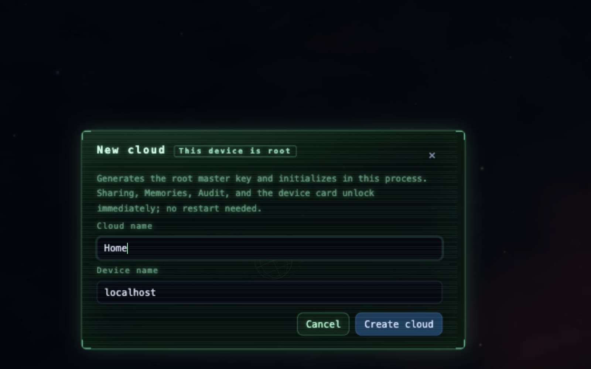

<div align="center">


**A distributed memory network for your AI assistants.**

Memory and tasks stay on your devices.<br>Devices sync directly. One shared graph.

[](https://github.com/Windsander/Mebular/actions/workflows/ci.yml) [](LICENSE) [](docs/getting-started/QUICKSTART.md) [](docs/getting-started/QUICKSTART.md)

[Website](https://mebular.cyberfederal.io) · [Quickstart](docs/getting-started/QUICKSTART.md) · [中文](README_CN.md)

</div>

---

<p align="center">
  
  
</p>
<p align="center"><sub>Create a Cloud on the first device · local view: five devices connected to this machine.<br>Blue and gold lines show each device's two-way authorization/connection to this machine, not peer-to-peer links.</sub></p>

## What it is

| Local-first | Direct sync | Auditable | MCP |
|---|---|---|---|
| Memory and tasks stay on your devices and keep working offline. | Devices sync directly. No hosted account, no central coordinator. | Every write is signed and content-addressed, so history can be checked. | Your existing assistants connect over stdio or HTTP. |

A Cloud (忆云) is one shared memory space in the network — not a hosted service.

## Why Mebular

| The usual setup | Mebular |
|---|---|
| Context stays inside one assistant or one machine. | Every connected assistant reads and writes the same graph. |
| Sync needs an account and a hosted service. | Each machine runs a node; devices exchange memory directly. |
| You cannot tell who changed what. | Signed writes with an auditable history. |

## Get started

### Desktop app


**Start deployment** → **Create new Cloud** / **Join existing Cloud** → **Invite device**.

The app runs on 64-bit macOS, Windows and Linux. If there is no build for your platform yet, use the browser or CLI path below.

### Other paths

<table width="100%">
  <thead>
    <tr>
      <th align="left">Path</th>
      <th align="left">Start with</th>
      <th align="left">Best for</th>
    </tr>
  </thead>
  <tbody>
    <tr>
      <td><strong>Browser</strong></td>
      <td><code>npm install -g @mebular/core</code> → <code>mebular serve</code></td>
      <td>The same console, no app</td>
    </tr>
    <tr>
      <td><strong>CLI</strong></td>
      <td><code>fleet quickstart</code> → <code>fleet invite</code> / <code>fleet join</code></td>
      <td>Scripts and headless machines</td>
    </tr>
    <tr>
      <td><strong>Agent</strong></td>
      <td><a href="packages/skill/SETUP.md">Install the skill</a>, then say “deploy Mebular”</td>
      <td>Hands-off setup</td>
    </tr>
  </tbody>
</table>

Browser, CLI and agent paths need Node.js 20 or newer.

```bash
npm install -g @mebular/core
mebular serve                                  # browser console
fleet quickstart --daemon                      # CLI start
mebular print-config --client opencode         # MCP config
```

## What you get

| You get | In practice |
|---|---|
| **Context that follows you** | Write once with `memory_write`; any connected assistant recalls it with `memory_query`. |
| **Work that moves** | `task_submit` hands a task to another assistant; progress stays on one chain. |
| **History you can check** | See who wrote a fact, when it changed, and what was true then. |
| **Memory you can take** | Canonical Memory Format and adapters for Obsidian, logs and JSON memo. |

## How it works


<p align="center"><sub>One node per machine. One graph across them.</sub></p>

Each machine runs one node; nodes sync memory and tasks directly. Add a device with one QR code or token — the master key stays on the root machine.


## Docs

<table width="100%">
  <thead>
    <tr>
      <th align="left">Start</th>
      <th align="left">Go deeper</th>
    </tr>
  </thead>
  <tbody>
    <tr>
      <td><strong><a href="docs/getting-started/QUICKSTART.md">Quickstart</a></strong><br><sub>Install, pair, and sync a second device</sub></td>
      <td><strong><a href="docs/architecture/ARCHITECT.md">Architecture</a></strong><br><sub>Nodes, sync, and trust boundaries</sub></td>
    </tr>
    <tr>
      <td><strong><a href="docs/console/README.md">Console</a></strong><br><sub>The local GUI and its pages</sub></td>
      <td><strong><a href="docs/limitations/LIMITATIONS.md">Limitations</a></strong><br><sub>Read before storing sensitive data</sub></td>
    </tr>
    <tr>
      <td><strong><a href="CHANGELOG.md">Changelog</a></strong><br><sub>Release notes</sub></td>
      <td><strong><a href="packages/fleet/RUNBOOK.md">Fleet runbook</a></strong><br><sub>Two-machine operations and WAN checks</sub></td>
    </tr>
    <tr>
      <td><strong><a href="CONTRIBUTING.md">Contributing</a></strong><br><sub>Quality gates and how to help</sub></td>
      <td><strong><a href="packages/skill/SETUP.md">Agent skills</a></strong><br><sub>Setup, memory policy, task playbook</sub></td>
    </tr>
    <tr>
      <td><strong><a href="docs/operations/RELEASE.md">Release SOP</a></strong><br><sub>How a release is cut</sub></td>
      <td><strong><a href="SEALING.md">Sealing contract</a></strong><br><sub>Protocol red lines and deferrals</sub></td>
    </tr>
  </tbody>
</table>

<details>
<summary>Who does what</summary>

| Who | Handles |
|---|---|
| **You** | One-time pairing, Cloud choice, invites, subscriptions. |
| **Your assistant** | Memory reads and writes, task claim and completion. |
| **Mebular** | Discovery, direct / relay / hole-punch, retries, certificates, service autostart. |

</details>

<details>
<summary>Use it from code</summary>

```ts
import { Mebular } from 'mebular';

const mebular = new Mebular({
  storagePath: './store.jsonl',
  deviceId: 'device-a',
  network: { enabled: false },
});

await mebular.initialize();
```

Runnable examples: [`examples/quickstart`](examples/quickstart/index.mjs) writes and recalls a preference; [`examples/two-devices`](examples/two-devices/index.mjs) demonstrates offline sync.

</details>

<div align="center">

v0.1.0 · early · MIT

</div>
