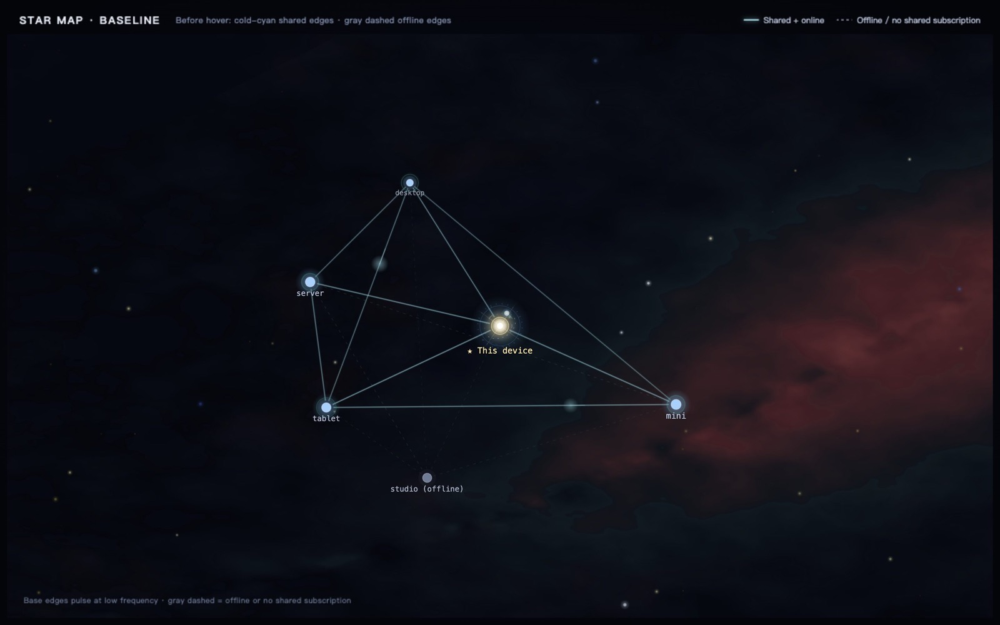
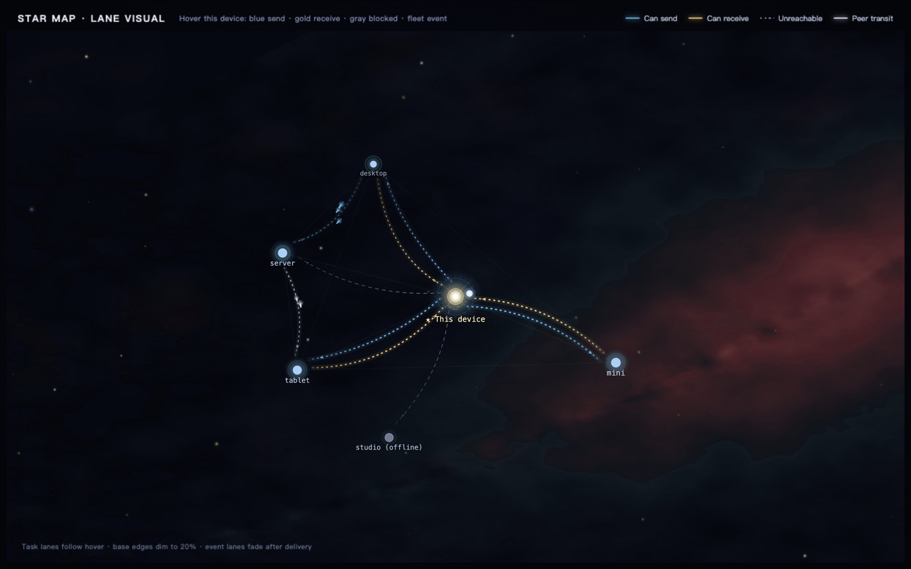
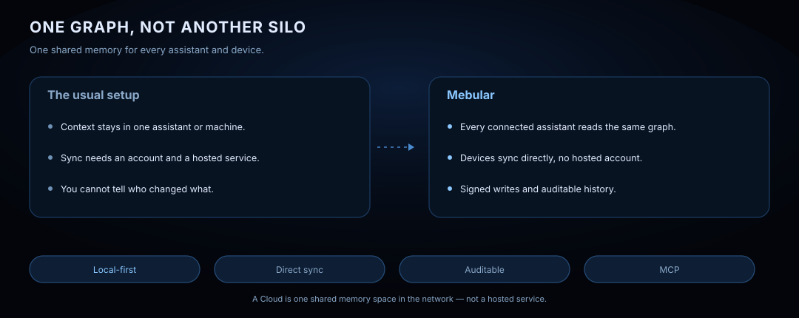
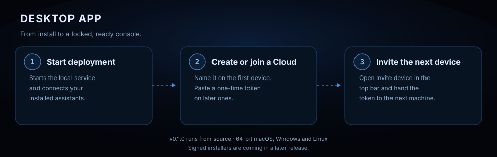
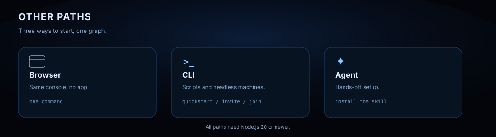
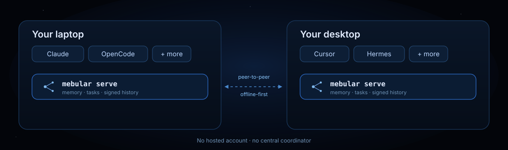
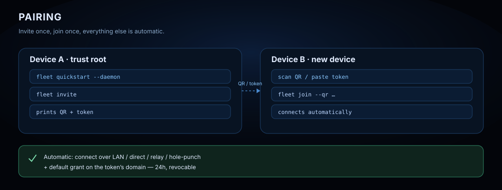

<div align="center">

<picture>
  <source media="(prefers-color-scheme: light)" srcset="assets/banner-light.svg">
  
</picture>

**One memory. Every assistant. Every device.**

A distributed memory network for your AI assistants.<br>
Memory and tasks stay on your devices; devices sync directly.

[](https://github.com/Windsander/Mebular/actions/workflows/ci.yml) [](LICENSE) [](docs/getting-started/QUICKSTART.md) [](docs/getting-started/QUICKSTART.md)

[Start in 5 minutes](docs/getting-started/QUICKSTART.md) · [How it works](docs/architecture/ARCHITECT.md) · [Website](https://mebular.cyberfederal.io) · [中文](README_CN.md)

<sub>No hosted account · No central coordinator</sub>

</div>

---

<p align="center">
  
  
</p>
<p align="center"><sub>The map at rest: devices and their shared-subscription edges. · On hover: task-domain lanes plus live fleet traffic.<br>Blue and gold show this device's two-way task-domain reachability, not peer-to-peer links.</sub></p>

## One memory

<p align="center">
  <picture>
    <source media="(prefers-color-scheme: light)" srcset="assets/one-graph-en-light.svg">
    
  </picture>
</p>

## Get started

<p align="center">
  <picture>
    <source media="(prefers-color-scheme: light)" srcset="assets/desktop-steps-en-light.svg">
    
  </picture>
</p>

<p align="center">
  <picture>
    <source media="(prefers-color-scheme: light)" srcset="assets/other-paths-en-light.svg">
    
  </picture>
</p>

**Desktop app (v0.1.0, unsigned).** [Download from GitHub Releases](https://github.com/Windsander/Mebular/releases/tag/v0.1.0): macOS Universal DMG, Windows x64 NSIS, Linux x64 AppImage and deb. Verify every file against `SHA256SUMS.txt` first. macOS needs right-click → **Open** (or Privacy & Security → **Open Anyway**); Windows SmartScreen needs **More info → Run anyway**. The app bundles Electron and its runtime, so it needs no local Node.js.

**Or install the CLI and server:**

```bash
npm install -g @mebular/core
mebular serve                                  # browser console
fleet quickstart --daemon                      # CLI start
mebular print-config --client opencode         # MCP config
```

## How it works

<p align="center">
  <picture>
    <source media="(prefers-color-scheme: light)" srcset="assets/network-overview-en-light.svg">
    
  </picture>
</p>

<p align="center"><sub>Write with <code>memory_write</code>, hand off with <code>task_submit</code> — the same graph, from any assistant.</sub></p>

<p align="center">
  <picture>
    <source media="(prefers-color-scheme: light)" srcset="assets/pairing-flow-en-light.svg">
    
  </picture>
</p>

## Docs

<table width="100%">
  <thead>
    <tr>
      <th align="left">Start</th>
      <th align="left">Learn</th>
      <th align="left">Run</th>
      <th align="left">Trust</th>
    </tr>
  </thead>
  <tbody>
    <tr>
      <td><strong><a href="docs/getting-started/QUICKSTART.md">Quickstart</a></strong><br><sub>Install &amp; pair</sub></td>
      <td><strong><a href="docs/architecture/ARCHITECT.md">Architecture</a></strong><br><sub>Nodes &amp; sync</sub></td>
      <td><strong><a href="docs/console/README.md">Console</a></strong><br><sub>Local GUI</sub></td>
      <td><strong><a href="docs/limitations/LIMITATIONS.md">Limitations</a></strong><br><sub>Sensitive data</sub></td>
    </tr>
    <tr>
      <td><strong><a href="packages/skill/SETUP.md">Agent skills</a></strong><br><sub>Setup playbooks</sub></td>
      <td><strong><a href="packages/fleet/RUNBOOK.md">Fleet ops</a></strong><br><sub>Multi-machine</sub></td>
      <td><strong><a href="docs/operations/RELEASE.md">Release SOP</a></strong><br><sub>Release steps</sub></td>
      <td><strong><a href="SEALING.md">Sealing docs</a></strong><br><sub>Protocol rules</sub></td>
    </tr>
    <tr>
      <td><strong><a href="CHANGELOG.md">Changelog</a></strong><br><sub>Release notes</sub></td>
      <td><strong><a href="CONTRIBUTING.md">Contributing</a></strong><br><sub>Quality gates</sub></td>
      <td><strong><a href="SECURITY.md">Security</a></strong><br><sub>Report a vuln</sub></td>
      <td><strong><a href="https://mebular.cyberfederal.io">Website</a></strong><br><sub>Product site</sub></td>
    </tr>
  </tbody>
</table>

<p align="center"><strong>Use with DSH</strong><br>
Keep the Mebular app running, then install the plugin from npm into DSH's web profile:<br>
<code>dsh plugin --profile web add @mebular/dsh-plugin@0.1.0</code><br>
A Mebular sidebar panel embeds the same Console through <code>?embed=dsh</code> (loopback only), and the official MCP client reaches the same graph. The plugin discovers the daemon by <code>daemonUrl &gt; MEBULAR_HTTP_PORT &gt; runtime.json &gt; 7331</code>, so custom ports follow automatically. It has its own version line and is not part of the five-package lockstep. For plugin development, install from <code>packages/dsh-plugin</code> instead.<br>
<a href="packages/dsh-plugin/README.md">DSH plugin guide →</a> · <a href="docs/integrations/DSH.md">Integration notes →</a></p>

<details>
<summary>Who does what</summary>

| Who | Handles |
|---|---|
| **You** | One-time pairing, Cloud choice, invites, subscriptions. |
| **Your assistant** | Memory reads and writes, task claim and completion. |
| **Mebular** | Discovery, direct / relay / hole-punch, retries, certificates, service autostart. |

</details>

<details>
<summary>Use it from code</summary>

```ts
import { Mebular } from 'mebular';

const mebular = new Mebular({
  storagePath: './store.jsonl',
  deviceId: 'device-a',
  network: { enabled: false },
});

await mebular.initialize();
```

Runnable examples: [`examples/quickstart`](examples/quickstart/index.mjs) writes and recalls a preference; [`examples/two-devices`](examples/two-devices/index.mjs) demonstrates offline sync.

</details>

<div align="center">

v0.1.0 · early · MIT

</div>
