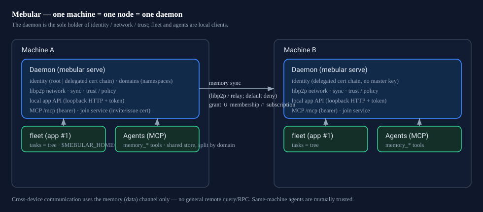

<div align="center">


# Mebular

**One local memory for all your AI assistants.**

Mebular runs on your own machines, so every assistant you use can share what it learns — across sessions, tools and devices.

[](https://github.com/Windsander/Mebular/actions/workflows/ci.yml)
[](LICENSE)

[Website](https://mebular.cyberfederal.io) · [Get started](#start-here) · [中文](README_CN.md)

</div>

---

## Start here

Mebular is a desktop app backed by one small service on your machine. No account, no server to rent, and no
Node.js install: the app sets the service up for you.

1. **Get the app.** Download it from [GitHub Releases](https://github.com/Windsander/Mebular/releases) and open
   it. It runs on macOS, Windows and Linux.
2. **Start deployment.** Mebular starts the local service on this machine and connects the AI assistants already
   installed on it. That is the whole setup — nothing is uploaded to a hosted service.
3. **Choose one.** The console opens locked: **Create new Cloud** on your first device, **Join existing Cloud**
   on any later one. A Cloud (忆云) is one shared memory space — not a hosted service.

Create and join both finish in the same process, on the same page: no daemon restart, no page reload, and the
console unlocks as soon as initialization returns. There is no hosted account to create at any point.

**What you will see.** The star map shows this machine as a single node, and the other console cards stay
disabled until a Cloud exists. After create or join, the top bar switches to **Invite device** and **Join
Cloud**, and the remaining cards light up. Invite your next machine from that top bar.

Adding a second device takes one token. On a device already in the Cloud, open **Invite device** for a QR code
or a one-time token; on the new machine, **Join existing Cloud** pastes it and receives a delegated
certificate. The master key is never copied, and each device then syncs on its own.

Requirements: a 64-bit macOS, Windows or Linux machine. The app manages its own local service, so no terminal
and no administrator setup are needed for the path above.

Prefer the terminal, or setting up a headless machine? The same console is served locally:

```bash
npm install -g @mebular/core   # then: mebular serve → http://127.0.0.1:7331/console
```

Full desktop, browser, CLI and source paths live in the [quickstart](docs/getting-started/QUICKSTART.md).

## What you can do

- **Keep context across sessions.** Your assistant writes a fact once with `memory_write`, and every assistant
  you connect can recall it later. No more re-explaining your stack, your preferences, or the decision you made
  last month.
- **Let work move between assistants.** Submit a task with `task_submit`, and another assistant — on this
  machine or another one — picks it up and reports back into the same memory. You can follow the whole chain
  instead of guessing what happened in the middle.
- **Connect the assistants you already use.** Mebular speaks MCP, so it plugs into the tools already on your
  machine. Nothing to rewrite, no vendor to switch to.

It is all one shared memory: a note your assistant writes in one tool is available to the next assistant, and
to the next machine after it syncs. You keep one place to look when you want to know what your assistants know.

## Why local-first

- **Your data stays on your devices.** There is no hosted Mebular service and no account: memory is written to local
  storage that you own and can back up.
- **You can audit every change.** Every write is signed and content-addressed, so you can always tell who
  changed what.
- **It works offline.** Unplug, keep working, reconnect later: devices catch up on their own and converge on the
  same memory.

Clouds sync device to device. That trade-off has limits — for example, any device inside one Cloud can read the
memory domains it subscribes to. Read [Limitations](docs/limitations/LIMITATIONS.md) before you put sensitive
data in.

## How it works



Each machine runs one local service that owns its identity, storage and sync. Your assistants connect to that
service over MCP, so they never talk to each other directly. Devices then exchange memory with each other, with
no central coordinator in the path.

## Learn more

- **Quickstart** — [desktop, browser, CLI and source setup](docs/getting-started/QUICKSTART.md)
- **Console** — [what the local GUI does](docs/console/README.md)
- **Architecture** — [runtime layers and trust model](docs/architecture/ARCHITECT.md)
- **Limitations** — [known limits and trade-offs](docs/limitations/LIMITATIONS.md)
- **Changelog** — [release notes](CHANGELOG.md)
- **Contributing** — [quality gates and how to help](CONTRIBUTING.md)

<div align="center">

v0.1.0 · early · MIT

</div>
