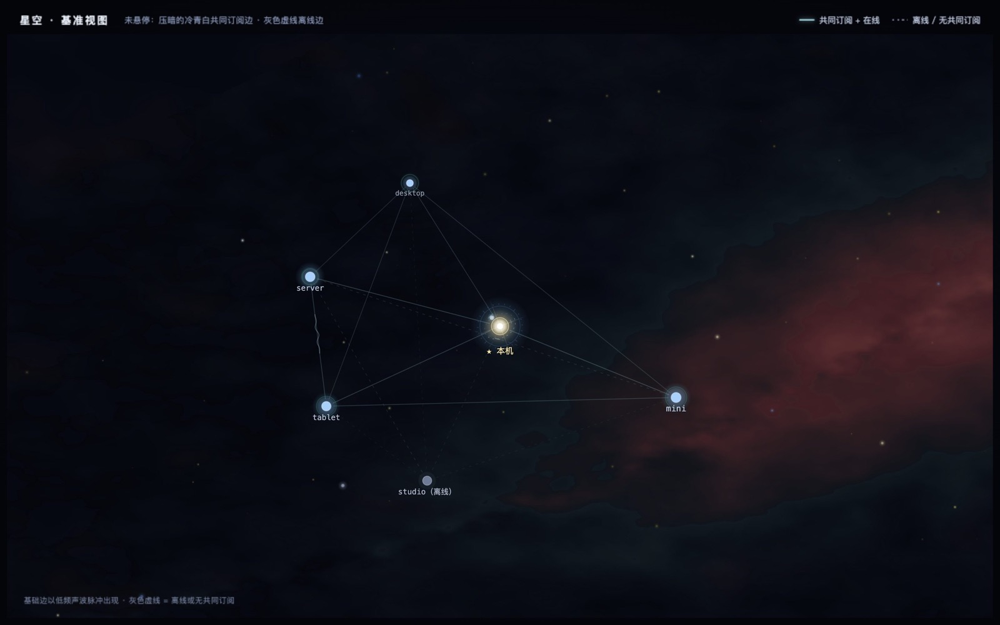
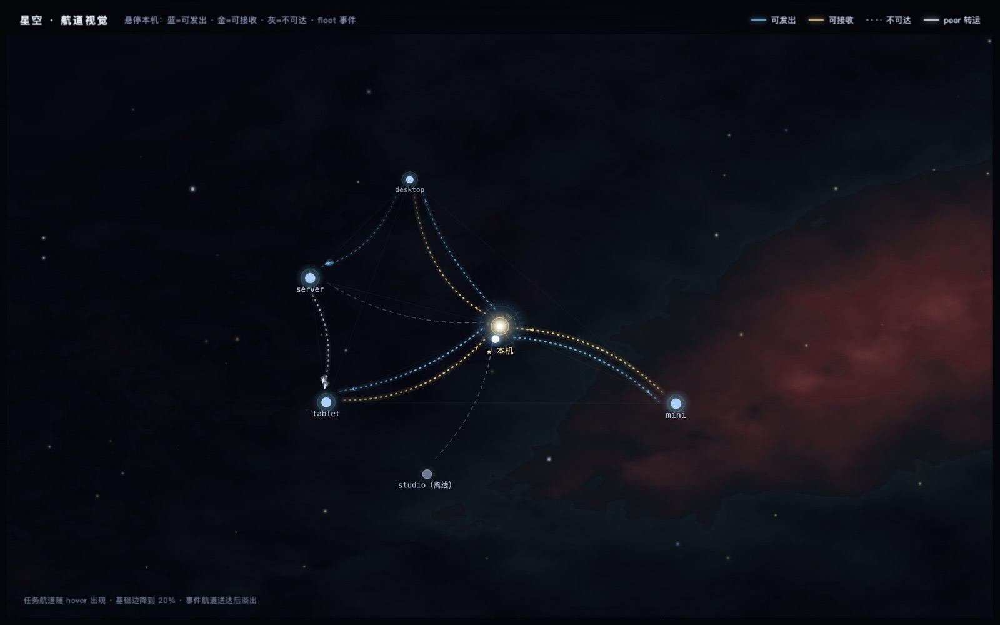
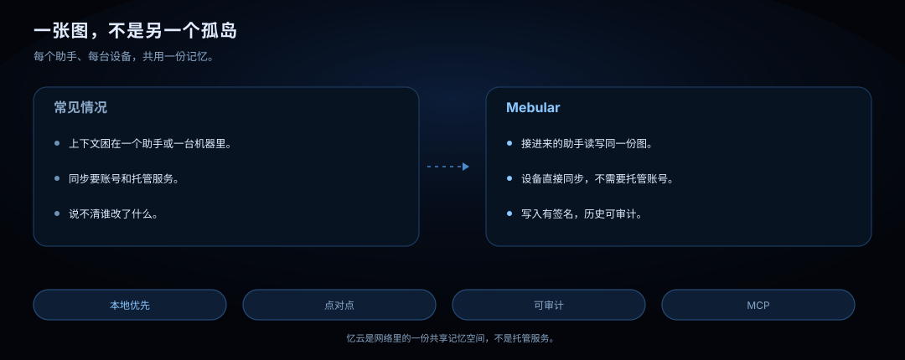
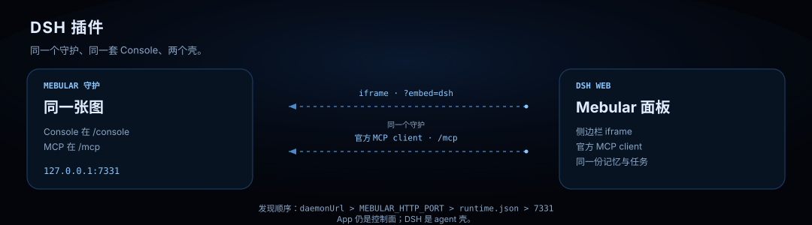
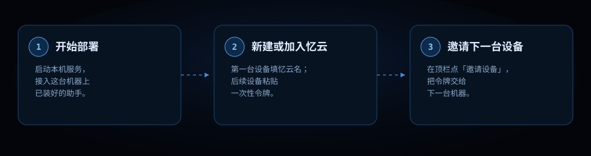
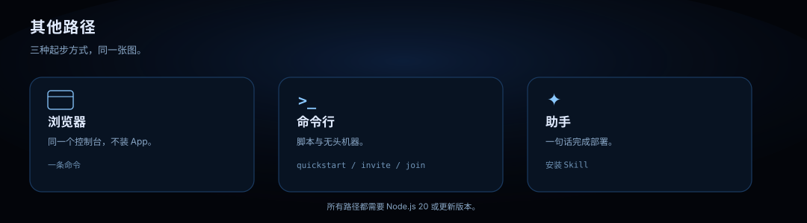
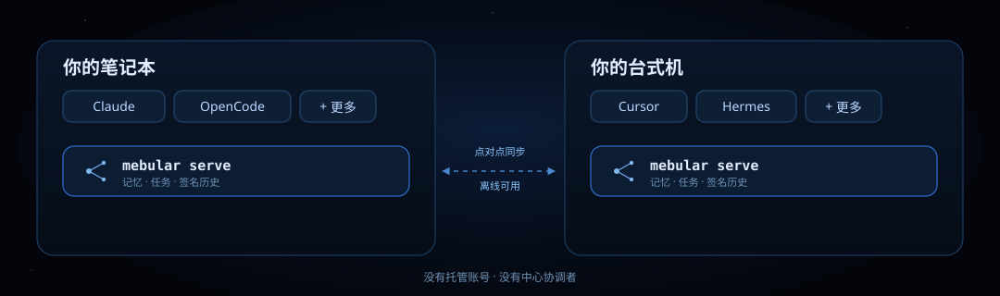
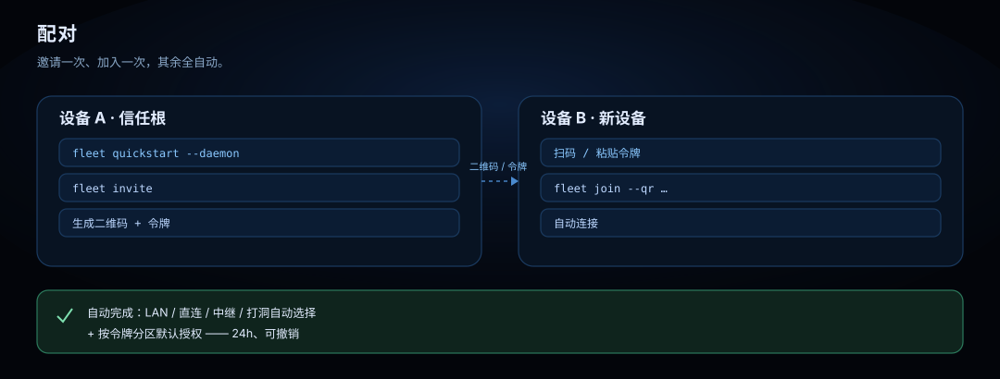

<div align="center">

<picture>
  <source media="(prefers-color-scheme: light)" srcset="assets/banner-light.svg">
  
</picture>

**一份记忆，每个助手，每台设备。**

面向 AI 助手的分布式记忆网络。<br>
记忆和任务留在你的设备上，设备之间直接同步。

[](https://github.com/Windsander/Mebular/actions/workflows/ci.yml) [](LICENSE) [](docs/getting-started/QUICKSTART_CN.md) [](docs/getting-started/QUICKSTART_CN.md) [](https://awesome-dsh-plugin.com/zh/p/Windsander/Mebular--packages-dsh-plugin/)

[5 分钟开始](docs/getting-started/QUICKSTART_CN.md) · [了解架构](docs/architecture/ARCHITECT.md) · [官网](https://mebular.cyberfederal.io) · [English](README.md)

<sub>不需要托管账号 · 没有中心协调者</sub>

</div>

---

<p align="center">
  
  
</p>
<p align="center"><sub>静止时的星图：设备与共同订阅关系。 · 悬停时：任务域航道与实时 fleet 流量。<br>蓝线与金线表示本机 ↔ 各设备的任务域双向可达关系，不是设备之间的互连。</sub></p>

## 一份记忆

<p align="center">
  <picture>
    <source media="(prefers-color-scheme: light)" srcset="assets/one-graph-cn-light.svg">
    
  </picture>
</p>

## 开始使用

<p align="center">
  <picture>
    <source media="(prefers-color-scheme: light)" srcset="assets/dsh-plugin-cn-light.svg">
    
  </picture>
</p>

<p align="center">
  <picture>
    <source media="(prefers-color-scheme: light)" srcset="assets/desktop-steps-cn-light.svg">
    
  </picture>
</p>

<p align="center">
  <picture>
    <source media="(prefers-color-scheme: light)" srcset="assets/other-paths-cn-light.svg">
    
  </picture>
</p>

<table width="100%">
  <thead>
    <tr>
      <th align="left" width="30%">桌面 App · v0.2.0</th>
      <th align="left">下载与首次打开</th>
    </tr>
  </thead>
  <tbody>
    <tr>
      <td><strong>未签名发布</strong><br><sub>macOS Universal · Windows x64 · Linux x64</sub></td>
      <td><a href="https://github.com/Windsander/Mebular/releases/tag/v0.2.0">从 GitHub Releases 下载</a><br><sub>用 <code>SHA256SUMS.txt</code> 校验。macOS：右键 →「打开」；Windows：「更多信息 → 仍要运行」。自带 Electron 与 runtime。</sub></td>
    </tr>
  </tbody>
</table>

**或者安装 CLI 与服务端：**

```bash
npm install -g @mebular/core
mebular serve                                  # 浏览器控制台
fleet quickstart --daemon                      # 命令行启动
mebular print-config --client opencode         # MCP 配置
```

## 它如何工作

<p align="center">
  <picture>
    <source media="(prefers-color-scheme: light)" srcset="assets/network-overview-cn-light.svg">
    
  </picture>
</p>

<p align="center"><sub>用 <code>memory_write</code> 写入，用 <code>task_submit</code> 交接——同一张图，任何助手都能用。</sub></p>

<p align="center">
  <picture>
    <source media="(prefers-color-scheme: light)" srcset="assets/pairing-flow-cn-light.svg">
    
  </picture>
</p>

## 文档

<table width="100%">
  <thead>
    <tr>
      <th align="left">开始</th>
      <th align="left">理解</th>
      <th align="left">运维</th>
      <th align="left">信任</th>
    </tr>
  </thead>
  <tbody>
    <tr>
      <td><strong><a href="docs/getting-started/QUICKSTART_CN.md">快速上手</a></strong><br><sub>安装与配对</sub></td>
      <td><strong><a href="docs/architecture/ARCHITECT.md">架构</a></strong><br><sub>节点与同步</sub></td>
      <td><strong><a href="docs/console/README.md">控制台</a></strong><br><sub>本地界面</sub></td>
      <td><strong><a href="docs/limitations/LIMITATIONS_CN.md">限制</a></strong><br><sub>敏感数据</sub></td>
    </tr>
    <tr>
      <td><strong><a href="packages/skill/SETUP.md">Agent</a></strong><br><sub>部署规约</sub></td>
      <td><strong><a href="packages/fleet/RUNBOOK.md">Fleet</a></strong><br><sub>多机操作</sub></td>
      <td><strong><a href="docs/operations/RELEASE.md">发布流程</a></strong><br><sub>发布步骤</sub></td>
      <td><strong><a href="SEALING_CN.md">封板契约</a></strong><br><sub>协议红线</sub></td>
    </tr>
    <tr>
      <td><strong><a href="CHANGELOG.md">变更日志</a></strong><br><sub>发布说明</sub></td>
      <td><strong><a href="CONTRIBUTING.md">参与贡献</a></strong><br><sub>质量门禁</sub></td>
      <td><strong><a href="SECURITY.md">安全</a></strong><br><sub>报告漏洞</sub></td>
      <td><strong><a href="https://mebular.cyberfederal.io">官网</a></strong><br><sub>产品站点</sub></td>
    </tr>
  </tbody>
</table>

<p align="center"><strong>与 DSH 一起使用</strong><br>
从 npm 把插件装入 DSH 的 web profile：<br>
<code>dsh plugin --profile web add @mebular/dsh-plugin@0.2.0</code><br>
App 与 DSH Plugin 是同一套本机 Mebular runtime 的两个等权入口：插件默认 <code>attach</code>，已有 App/CLI/service 时直接连接，不会启动或下载任何东西。完全没有 runtime 时，面板会先询问，再按需安装固定版本共享 runtime。侧边栏面板通过 <code>?embed=dsh</code>（仅 loopback）嵌入同一套 Console，官方 MCP client 连接同一张图。插件是独立适配器，代码隔离在 <code>packages/dsh-plugin</code>；它由独立 npm job 发布，版本随统一 release train；开发时仍可从 <code>packages/dsh-plugin</code> 本地安装。<br>
已收录于 <a href="https://github.com/awesome-dsh-plugin/awesome-dsh-plugin">awesome-dsh-plugin</a> 的 <code>memory</code> 分类。<br>
<a href="packages/dsh-plugin/README.md">DSH 插件指南 →</a> · <a href="docs/integrations/DSH_CN.md">集成说明 →</a></p>

<details>
<summary>谁做什么</summary>

| 谁 | 管什么 |
|---|---|
| **你** | 一次性配对、选择忆云、邀请设备、管理订阅。 |
| **你的助手** | 读写记忆、接手并完成任务。 |
| **Mebular** | 发现与寻址、直连 / 中继 / 打洞、重试、证书、服务自启。 |

</details>

<details>
<summary>在代码里使用</summary>

```ts
import { Mebular } from 'mebular';

const mebular = new Mebular({
  storagePath: './store.jsonl',
  deviceId: 'device-a',
  network: { enabled: false },
});

await mebular.initialize();
```

可运行示例：[`examples/quickstart`](examples/quickstart/index.mjs) 写入并召回一条偏好；[`examples/two-devices`](examples/two-devices/index.mjs) 演示双设备离线同步。

</details>

<div align="center">

v0.2.0 · early · MIT · © 2026 Sobert Li

</div>
