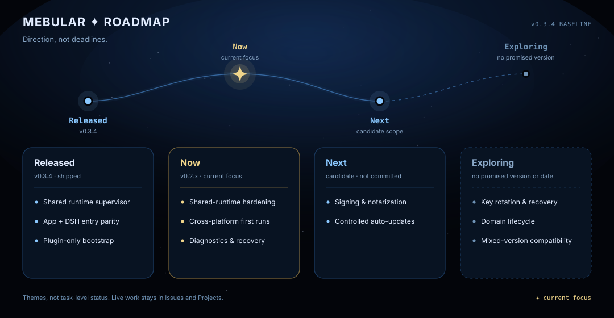

<!-- Canonical source for the pinned Roadmap Discussion. Keep asset and document URLs absolute so this file can be republished without rewriting. -->
# Mebular roadmap

[中文路线图](https://github.com/Windsander/Mebular/blob/main/ROADMAP_CN.md) · [Discussions](https://github.com/Windsander/Mebular/discussions) · [Live planning](https://github.com/Windsander/Mebular/projects)

> **Direction, not deadlines.** This roadmap records public product themes, not promised release dates. The text below is authoritative; the graphic is its visual summary. Issues and the public Project carry live task status.

<picture>
  <source media="(prefers-color-scheme: light)" srcset="https://raw.githubusercontent.com/Windsander/Mebular/main/assets/roadmap-en-light.svg">
  
</picture>

## Released — v0.3.4

Available in the [v0.3.4 release](https://github.com/Windsander/Mebular/releases/tag/v0.3.4).

- **Memory Runtime** — opt-in sidecar for automatic capture, recall, durable details, checkpoints and local extraction/summary.
- **Three host paths** — DSH, Hermes and OpenCode/OpenChamber adapters share one graph, event log and sync layer.
- **Local model supply** — explicit model/engine installation with fixed revisions, size and SHA-256 verification; no silent download.
- **Runtime stability contract** — lifecycle, local data, detail evidence, checkpoint revisions, host failure states and diagnostics now match the documented contract; Fleet black-box orchestration and a unified executor/adapter layer with the public OpenChamber runner shipped alongside.
- **Console settings v2** — a rebuilt settings shell (General, Security, Memory, Integrations, MCP, Advanced plus About device) with responsive layouts at 1440/1024/900/390, bilingual copy, accessible focus and reduced-motion behavior. No data, protocol or MCP-tool migration.

## Now — v0.3.x

The current stabilization focus after v0.3.4. Priorities can move in response to reproducible reports and first-run feedback.

- **Data lifecycle and privacy** — keep staging, settled details, host copies, retention and deletion boundaries explicit.
- **Lifecycle and recovery** — validate managed/attached/manual sidecars, offline queues, Compact/Checkpoint/SelfRecord and host fail-open behavior.
- **Evidence at real scale** — maintain the 1k/2k/10k audit, real-model canary, host E2E and upgrade/rollback evidence as release gates.

## Next — candidate themes

Known follow-up work. These themes are **not** a committed v0.3.x scope or release schedule.

- **Trusted desktop distribution** — advance the existing desktop signing and notarization plan.
- **Controlled updates** — explore auto-update while preserving explicit consent, shared-runtime ownership and rollback.

## Exploring

Open problems only. Inclusion here does not commit to a design, version or date.

- **Key rotation and recovery** — investigate master-key rotation, re-anchoring and an in-product recovery path.
- **Domain lifecycle** — investigate safe deletion semantics for memory domains.
- **Mixed-version compatibility** — investigate upgrade windows instead of requiring every device to run the same version.

The current behavior and trade-offs behind these topics are documented in [Limitations](https://github.com/Windsander/Mebular/blob/main/docs/limitations/LIMITATIONS.md).

## Participate

- **Report a reproducible problem:** [Issues](https://github.com/Windsander/Mebular/issues)
- **Ask about installation or usage:** [Q&A](https://github.com/Windsander/Mebular/discussions/categories/q-a)
- **Propose a use case or direction:** [Ideas](https://github.com/Windsander/Mebular/discussions/categories/ideas)
- **Inspect live task status:** [GitHub Projects](https://github.com/Windsander/Mebular/projects)

Do not use roadmap comments for vulnerability reports; use [Private Vulnerability Reporting](https://github.com/Windsander/Mebular/security/advisories/new).

This roadmap is reviewed at release boundaries and when community feedback materially changes priorities. Update it through a pull request, then refresh the pinned Discussion and public Project instead of creating competing roadmap copies.

---

Canonical source: [ROADMAP.md](https://github.com/Windsander/Mebular/blob/main/ROADMAP.md) · [Contribute](https://github.com/Windsander/Mebular/blob/main/CONTRIBUTING.md)
