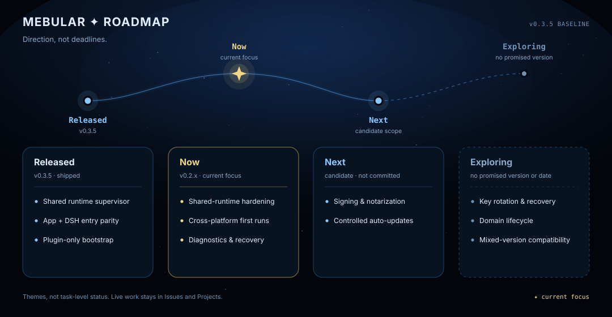

<!-- Canonical source for the pinned Roadmap Discussion. Keep asset and document URLs absolute so this file can be republished without rewriting. -->
# Mebular roadmap

[中文路线图](https://github.com/Windsander/Mebular/blob/main/ROADMAP_CN.md) · [Discussions](https://github.com/Windsander/Mebular/discussions) · [Live planning](https://github.com/Windsander/Mebular/projects)

> **Direction, not deadlines.** This roadmap records public product themes, not promised release dates. The text below is authoritative; the graphic is its visual summary. Issues and the public Project carry live task status.

<picture>
  <source media="(prefers-color-scheme: light)" srcset="https://raw.githubusercontent.com/Windsander/Mebular/main/assets/roadmap-en-light.svg">
  
</picture>

## Released — v0.3.5

Current release: [v0.3.5](https://github.com/Windsander/Mebular/releases/tag/v0.3.5). The foundation below shipped across v0.3.0–v0.3.4.

- **v0.3.5 acceptance hardening** — Runtime page redesign plus DSH route authentication, home-path minimization, CLI help and test-isolation fixes. The 29-tool MCP surface, data formats and host adapters are unchanged.
- **Memory Runtime** — opt-in sidecar for automatic capture, recall, durable details, checkpoints and local extraction/summary.
- **Three host paths** — DSH, Hermes and OpenCode/OpenChamber adapters share one graph, event log and sync layer.
- **Local model supply** — explicit model/engine installation with fixed revisions, size and SHA-256 verification; no silent download.
- **Runtime stability contract** — lifecycle, local data, detail evidence, checkpoint revisions, host failure states and diagnostics now match the documented contract; Fleet black-box orchestration and a unified executor/adapter layer with the public OpenChamber runner shipped alongside.
- **Console settings v2** — a rebuilt settings shell (General, Security, Memory, Integrations, MCP, Advanced plus About device) with responsive layouts at 1440/1024/900/390, bilingual copy, accessible focus and reduced-motion behavior. No data, protocol or MCP-tool migration.

## Now — v0.4.0 (in development)

The 0.4.0 line is the **Memory Intervention Policy** — the main theme is moving memory
from recall to **timing**: when to bring a memory back, and how deep to bring it. It is
**not released yet**; this section records the target scope, not a promised date.

- **Memory Intervention Policy** — from recall to timing; `when × how deep`; `speak` /
  `defer` / `silent` and `gist` / `detail` / `quote`, with `must_speak` hard rules and
  default `off`.
- **Decision and outcome trace** — `decision` / `applied` / `outcome` on the existing
  local RecallTrace; outcome API and OpenCode attribution first.
- **Effective mode and canary** — production has one selector, `model.source`; a missing
  source stays `off`, `heuristic` runs local rules, and `local` / `host` / `api` / `auto`
  select the model planner. `shadow` is an internal diagnostic/canary state, not a
  user-selectable mode, and the old `intervention.mode` only emits a compatibility
  warning.
- **Console observability only** — decision/outcome/would* fields on Runtime traces and
  a confirmed local policy reset. 0.4.0 is the intervention mechanism, not a Console UI
  upgrade.
- **Model sources and adaptive** — local is assisted/shadow in 0.4.0 (authoritative local
  planning is a separate 0.4.2 line); API is the only synchronous source; host consumes a
  session-prior plan. Per-domain adaptive thresholds apply only to `heuristic` decisions
  and default to the internal `shadow` stage.

Boundaries: default `off`; `self → checkpoint → compact/fragment` recovery semantics are
unchanged; no desktop pop-ups, no cross-device policy sync and no visible proactive
reminder UI in 0.4.0. Full design and limits:
[0.4.0 Intervention Policy](https://github.com/Windsander/Mebular/blob/main/docs/design/0.4.0-intervention-policy.md).

## Now — v0.3.x

The current stabilization focus after v0.3.5. Priorities can move in response to reproducible reports and first-run feedback.

- **Data lifecycle and privacy** — keep staging, settled details, host copies, retention and deletion boundaries explicit. Tracking: [#329](https://github.com/Windsander/Mebular/issues/329).
- **Lifecycle and recovery** — validate managed/attached/manual sidecars, offline queues, Compact/Checkpoint/SelfRecord and host fail-open behavior. Tracking: [#266](https://github.com/Windsander/Mebular/issues/266).
- **Evidence at real scale** — maintain the 1k/2k/10k audit, real-model canary, host E2E and upgrade/rollback evidence as release gates. Tracking: [#330](https://github.com/Windsander/Mebular/issues/330).
- **First-run and cross-platform guidance** — turn macOS, Windows and Linux first-run reports into fixes and clearer setup or recovery guidance. Tracking: [#265](https://github.com/Windsander/Mebular/issues/265).

## Next — candidate themes

Known follow-up work. These themes are **not** a committed v0.3.x scope or release schedule.

- **Trusted desktop distribution** — advance the existing desktop signing and notarization plan. Tracking: [#267](https://github.com/Windsander/Mebular/issues/267).
- **Controlled updates** — explore auto-update while preserving explicit consent, shared-runtime ownership and rollback. Tracking: [#268](https://github.com/Windsander/Mebular/issues/268).

## Exploring

Open problems only. Inclusion here does not commit to a design, version or date.

- **Key rotation and recovery** — investigate master-key rotation, re-anchoring and an in-product recovery path. Tracking: [#326](https://github.com/Windsander/Mebular/issues/326).
- **Domain lifecycle** — investigate safe deletion semantics for memory domains. Tracking: [#327](https://github.com/Windsander/Mebular/issues/327).
- **Mixed-version compatibility** — investigate upgrade windows instead of requiring every device to run the same version. Tracking: [#328](https://github.com/Windsander/Mebular/issues/328).

The current behavior and trade-offs behind these topics are documented in [Limitations](https://github.com/Windsander/Mebular/blob/main/docs/limitations/LIMITATIONS.md).

## Participate

- **Report a reproducible problem:** [Issues](https://github.com/Windsander/Mebular/issues)
- **Ask about installation or usage:** [Q&A](https://github.com/Windsander/Mebular/discussions/categories/q-a)
- **Propose a use case or direction:** [Ideas](https://github.com/Windsander/Mebular/discussions/categories/ideas)
- **Inspect live task status:** [GitHub Projects](https://github.com/Windsander/Mebular/projects)

Do not use roadmap comments for vulnerability reports; use [Private Vulnerability Reporting](https://github.com/Windsander/Mebular/security/advisories/new).

This roadmap is reviewed at release boundaries and when community feedback materially changes priorities. Update it through a pull request, then refresh the pinned Discussion and public Project instead of creating competing roadmap copies.

---

Canonical source: [ROADMAP.md](https://github.com/Windsander/Mebular/blob/main/ROADMAP.md) · [Contribute](https://github.com/Windsander/Mebular/blob/main/CONTRIBUTING.md)
