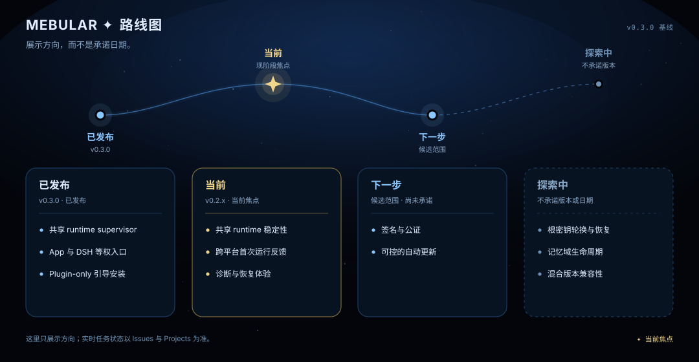

<!-- 置顶 Roadmap Discussion 的规范来源。资源与文档链接保持绝对地址，便于原样重新发布。 -->
# Mebular 路线图

[English roadmap](https://github.com/Windsander/Mebular/blob/main/ROADMAP.md) · [Discussions](https://github.com/Windsander/Mebular/discussions) · [实时规划](https://github.com/Windsander/Mebular/projects)

> **展示方向，而不是承诺日期。** 这里记录公开的产品主题，不承诺发布日期。下方文字是正式依据，图片是其视觉摘要；实时任务状态以 Issues 和公开 Project 为准。

<picture>
  <source media="(prefers-color-scheme: light)" srcset="https://raw.githubusercontent.com/Windsander/Mebular/main/assets/roadmap-cn-light.svg">
  
</picture>

## 已发布 — v0.3.0

已在 [v0.3.0](https://github.com/Windsander/Mebular/releases/tag/v0.3.0) 中提供。

- **Memory Runtime** —— 可选 sidecar：自动采集、召回、持久详情、检查点和本地抽取/摘要。
- **三条宿主接入** —— DSH、Hermes 与 OpenCode/OpenChamber 适配器共用同一张图、事件日志和同步层。
- **本地模型供应** —— 显式安装模型/引擎，固定 revision、大小和 SHA-256 校验；不会静默下载。

## 当前 — v0.3.x

现阶段的稳定化重点。优先级会根据可复现报告和首次运行反馈调整。

- **数据生命周期与隐私** —— 让 staging、已沉降详情、宿主副本、保留和删除边界保持明确。
- **生命周期与恢复** —— 验证 managed/attached/manual sidecar、离线队列、Compact/Checkpoint/SelfRecord 和宿主 fail-open 行为。
- **真实规模证据** —— 把 1k/2k/10k 审计、真实模型 canary、宿主 E2E 和升级/回滚证据作为发布门禁。

## 下一步 — 候选主题

已经记录的后续工作。这些主题**不代表**已经承诺的 v0.3.x 范围或发布计划。

- **可信桌面分发** —— 推进现有的桌面签名与公证计划。
- **受控更新** —— 探索自动更新，同时保留明确授权、共享 runtime 所有权和回滚能力。

## 探索中

这里只记录开放问题，不代表已经承诺设计、版本或日期。

- **密钥轮换与恢复** —— 研究主密钥轮换、重新锚定和产品内恢复路径。
- **记忆域生命周期** —— 研究记忆域的安全删除语义。
- **混合版本兼容性** —— 研究升级窗口，避免强制所有设备始终运行同一版本。

这些主题对应的当前行为与取舍见[已知边界](https://github.com/Windsander/Mebular/blob/main/docs/limitations/LIMITATIONS_CN.md)。

## 参与方式

- **报告可复现问题：** [Issues](https://github.com/Windsander/Mebular/issues)
- **询问安装或使用问题：** [Q&A](https://github.com/Windsander/Mebular/discussions/categories/q-a)
- **提出用例或方向建议：** [Ideas](https://github.com/Windsander/Mebular/discussions/categories/ideas)
- **查看实时任务状态：** [GitHub Projects](https://github.com/Windsander/Mebular/projects)

请勿在路线图评论中报告安全漏洞；请使用 [GitHub 私密漏洞报告](https://github.com/Windsander/Mebular/security/advisories/new)。

路线图会在版本发布时，以及社区反馈实质改变优先级时复审。请通过 PR 更新本文，合入后再刷新置顶 Discussion 和公开 Project，不维护相互竞争的其他路线图副本。

---

规范来源：[ROADMAP_CN.md](https://github.com/Windsander/Mebular/blob/main/ROADMAP_CN.md) · [参与贡献](https://github.com/Windsander/Mebular/blob/main/CONTRIBUTING.md)
