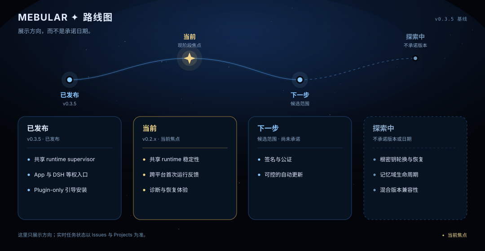

<!-- 置顶 Roadmap Discussion 的规范来源。资源与文档链接保持绝对地址，便于原样重新发布。 -->
# Mebular 路线图

[English roadmap](https://github.com/Windsander/Mebular/blob/main/ROADMAP.md) · [Discussions](https://github.com/Windsander/Mebular/discussions) · [实时规划](https://github.com/Windsander/Mebular/projects)

> **展示方向，而不是承诺日期。** 这里记录公开的产品主题，不承诺发布日期。下方文字是正式依据，图片是其视觉摘要；实时任务状态以 Issues 和公开 Project 为准。

<picture>
  <source media="(prefers-color-scheme: light)" srcset="https://raw.githubusercontent.com/Windsander/Mebular/main/assets/roadmap-cn-light.svg">
  
</picture>

## 已发布 — v0.3.5

当前版本：[v0.3.5](https://github.com/Windsander/Mebular/releases/tag/v0.3.5)。以下基础能力跨越 v0.3.0–v0.3.4 交付。

- **v0.3.5 验收硬化** —— Runtime 页面重构，加上 DSH 路由鉴权、home 路径最小化、CLI 帮助与测试隔离修复。29 个 MCP 工具、数据格式与宿主适配器均未变化。
- **Memory Runtime** —— 可选 sidecar：自动采集、召回、持久详情、检查点和本地抽取/摘要。
- **三条宿主接入** —— DSH、Hermes 与 OpenCode/OpenChamber 适配器共用同一张图、事件日志和同步层。
- **本地模型供应** —— 显式安装模型/引擎，固定 revision、大小和 SHA-256 校验；不会静默下载。
- **运行时稳定性契约** —— 生命周期、本地数据、详情证据、检查点修订、宿主失败状态与诊断已与文档契约对齐；同期加入 Fleet 黑盒编排，以及带公开 OpenChamber runner 的统一执行器/适配层。
- **Console 设置 v2** —— 重建设置外壳（通用、安全、记忆、集成、MCP、高级，另含关于设备），覆盖 1440/1024/900/390 响应式布局、中英文案、可访问焦点与减少动效行为。不涉及数据、协议或 MCP 工具迁移。

## 当前 — v0.4.0（开发中）

0.4.0 的主线是**记忆介入策略（Memory Intervention Policy）**：把记忆从“召回”推进到
**时机**——什么时候把记忆带回来、带多深。它**尚未发布**；本节记录目标范围，不承诺日期。

- **记忆介入策略** —— from recall to timing；`when × how deep`；`speak` / `defer` /
  `silent` 与 `gist` / `detail` / `quote`，带 `must_speak` 硬规则，默认 `off`。
- **决策与结果 trace** —— 在现有本机 RecallTrace 上增加 `decision` / `applied` /
  `outcome`；先接 OpenCode 的 outcome 上报。
- **生效模式与 canary** —— 生产只有一个选择器 `model.source`：缺失即 `off`，
  `heuristic` 走本机规则，`local` / `host` / `api` / `auto` 选择模型 planner。`shadow`
  只是内部 diagnostic/canary 状态，不是用户可选模式；旧 `intervention.mode` 只发兼容
  warning。
- **Console 只做可观测性** —— Runtime trace 展示 decision/outcome/would*，并提供二次确认
  的本机策略 reset。0.4.0 的主题是介入机制，不是 Console UI 升级。
- **模型来源与自适应** —— 0.4.0 的 local 是 assisted/shadow（权威 local planner 属于
  独立的 0.4.2 线）；API 是唯一同步来源；host 消费上一轮后的 session-prior plan。按域
  自适应阈值只作用于 `heuristic` 决策，内部 stage 默认 `shadow`。

边界：默认 `off`；`self → checkpoint → compact/fragment` 的恢复语义不变；0.4.0 不做桌面
弹窗、不做跨设备策略同步，也不做可见的主动提醒 UI。完整设计与限制见
[0.4.0 介入策略](https://github.com/Windsander/Mebular/blob/main/docs/design/0.4.0-intervention-policy.md)。

## 当前 — v0.3.x

现阶段的稳定化重点，起点为 v0.3.5。优先级会根据可复现报告和首次运行反馈调整。

- **数据生命周期与隐私** —— 让 staging、已沉降详情、宿主副本、保留和删除边界保持明确。跟踪：[#329](https://github.com/Windsander/Mebular/issues/329)。
- **生命周期与恢复** —— 验证 managed/attached/manual sidecar、离线队列、Compact/Checkpoint/SelfRecord 和宿主 fail-open 行为。跟踪：[#266](https://github.com/Windsander/Mebular/issues/266)。
- **真实规模证据** —— 把 1k/2k/10k 审计、真实模型 canary、宿主 E2E 和升级/回滚证据作为发布门禁。跟踪：[#330](https://github.com/Windsander/Mebular/issues/330)。
- **首次运行与跨平台引导** —— 把 macOS、Windows、Linux 的首次运行报告转化为修复，以及更清晰的安装或恢复指引。跟踪：[#265](https://github.com/Windsander/Mebular/issues/265)。

## 下一步 — 候选主题

已经记录的后续工作。这些主题**不代表**已经承诺的 v0.3.x 范围或发布计划。

- **可信桌面分发** —— 推进现有的桌面签名与公证计划。跟踪：[#267](https://github.com/Windsander/Mebular/issues/267)。
- **受控更新** —— 探索自动更新，同时保留明确授权、共享 runtime 所有权和回滚能力。跟踪：[#268](https://github.com/Windsander/Mebular/issues/268)。

## 探索中

这里只记录开放问题，不代表已经承诺设计、版本或日期。

- **密钥轮换与恢复** —— 研究主密钥轮换、重新锚定和产品内恢复路径。跟踪：[#326](https://github.com/Windsander/Mebular/issues/326)。
- **记忆域生命周期** —— 研究记忆域的安全删除语义。跟踪：[#327](https://github.com/Windsander/Mebular/issues/327)。
- **混合版本兼容性** —— 研究升级窗口，避免强制所有设备始终运行同一版本。跟踪：[#328](https://github.com/Windsander/Mebular/issues/328)。

这些主题对应的当前行为与取舍见[已知边界](https://github.com/Windsander/Mebular/blob/main/docs/limitations/LIMITATIONS_CN.md)。

## 参与方式

- **报告可复现问题：** [Issues](https://github.com/Windsander/Mebular/issues)
- **询问安装或使用问题：** [Q&A](https://github.com/Windsander/Mebular/discussions/categories/q-a)
- **提出用例或方向建议：** [Ideas](https://github.com/Windsander/Mebular/discussions/categories/ideas)
- **查看实时任务状态：** [GitHub Projects](https://github.com/Windsander/Mebular/projects)

请勿在路线图评论中报告安全漏洞；请使用 [GitHub 私密漏洞报告](https://github.com/Windsander/Mebular/security/advisories/new)。

路线图会在版本发布时，以及社区反馈实质改变优先级时复审。请通过 PR 更新本文，合入后再刷新置顶 Discussion 和公开 Project，不维护相互竞争的其他路线图副本。

---

规范来源：[ROADMAP_CN.md](https://github.com/Windsander/Mebular/blob/main/ROADMAP_CN.md) · [参与贡献](https://github.com/Windsander/Mebular/blob/main/CONTRIBUTING.md)
