<div align="center">


**一份记忆，每个助手，每台设备。**

面向 AI 助手的分布式记忆网络。记忆和任务留在你的设备上，设备之间直接同步。

[](https://github.com/Windsander/Mebular/actions/workflows/ci.yml) [](https://github.com/Windsander/Mebular/blob/main/LICENSE) [](https://github.com/Windsander/Mebular/blob/main/docs/getting-started/QUICKSTART_CN.md) [](https://github.com/Windsander/Mebular/blob/main/docs/getting-started/QUICKSTART_CN.md) [](https://awesome-dsh-plugin.com/zh/p/Windsander/Mebular--packages-dsh-plugin/)

[5 分钟开始](https://github.com/Windsander/Mebular/blob/main/docs/getting-started/QUICKSTART_CN.md) · [了解架构](https://github.com/Windsander/Mebular/blob/main/docs/architecture/ARCHITECT.md) · [官网](https://mebular.cyberfederal.io) · [English](https://github.com/Windsander/Mebular/blob/main/packages/dsh-plugin/README_EN.md)

*不需要托管账号 · 没有中心协调者*

App 与 DSH Plugin 是同一套本机 runtime 的两个入口。插件默认 `attach`，
不会静默启动或下载；没有 runtime 时先询问。

</div>

---

<div align="center">

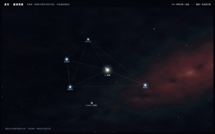 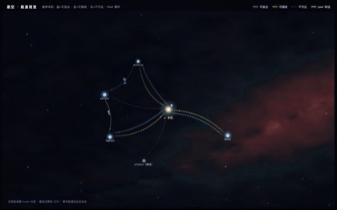

*静止时的星图：设备与共同订阅关系。 · 悬停时：任务域航道与实时 fleet 流量。蓝线与金线表示本机 ↔ 各设备的任务域双向可达关系，不是设备之间的互连。*

</div>

| 完整 DSH 面板 · 入口与星图 | 折叠侧栏 · Console 全宽 | 共享记忆视图 | 设置与常驻配置 |
| --- | --- | --- | --- |
| [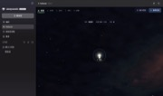](https://raw.githubusercontent.com/Windsander/Mebular/HEAD/assets/dsh-plugin-demo-cn-normal.jpg) | [](https://raw.githubusercontent.com/Windsander/Mebular/HEAD/assets/dsh-plugin-demo-cn-collapsed.jpg) | [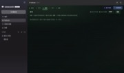](https://raw.githubusercontent.com/Windsander/Mebular/HEAD/assets/dsh-plugin-demo-cn-memories.jpg) | [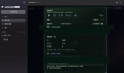](https://raw.githubusercontent.com/Windsander/Mebular/HEAD/assets/dsh-plugin-demo-cn-settings.jpg) |

## 运行方式

<div align="center">

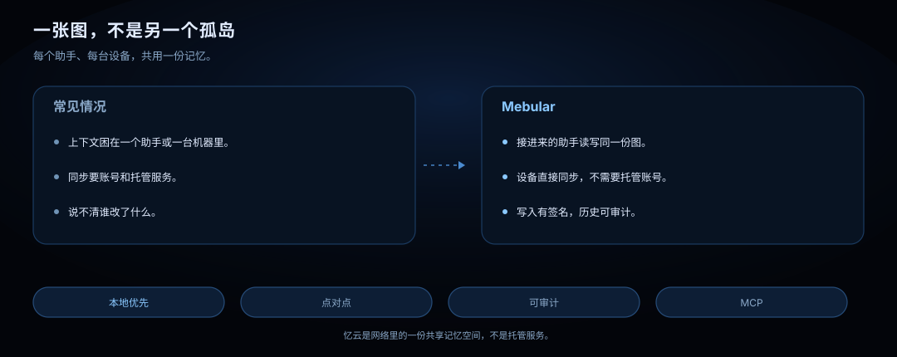

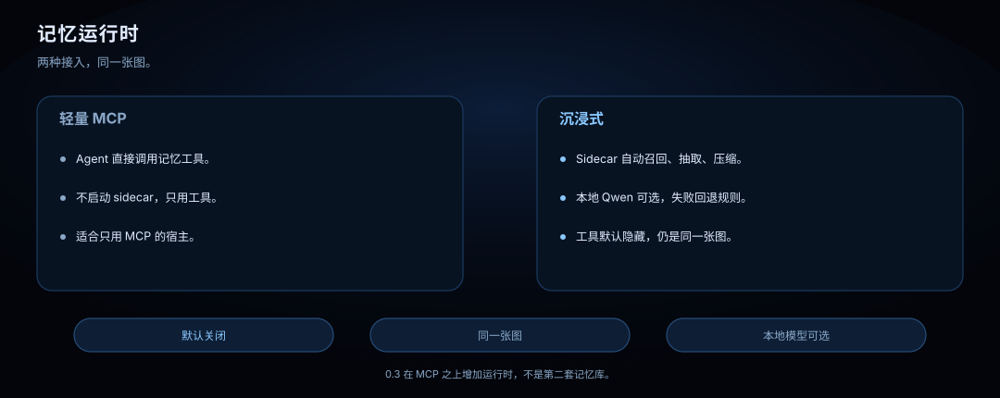

*0.3 在 MCP 之上增加可选运行时。默认关闭；本地 Qwen 可选。*

[运行方式指南](https://github.com/Windsander/Mebular/blob/main/docs/guides/MEMORY_RUNTIME_CN.md) · [DSH 集成](https://github.com/Windsander/Mebular/blob/main/docs/integrations/DSH_CN.md)

</div>

## DSH 接入

<div align="center">

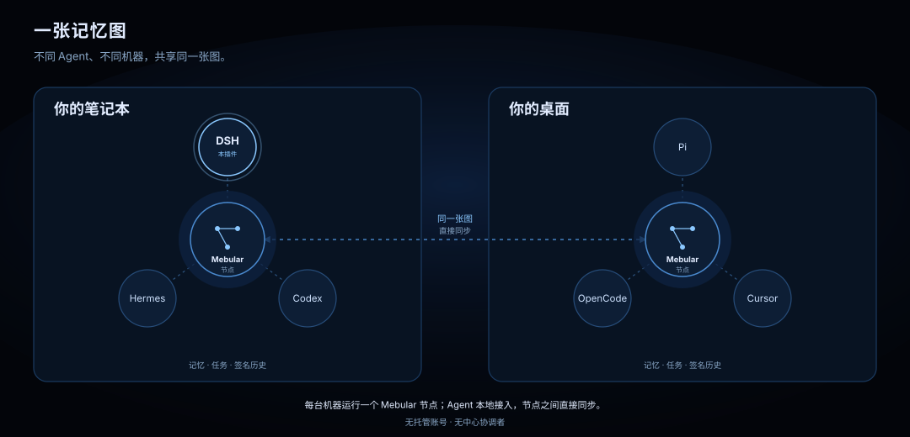

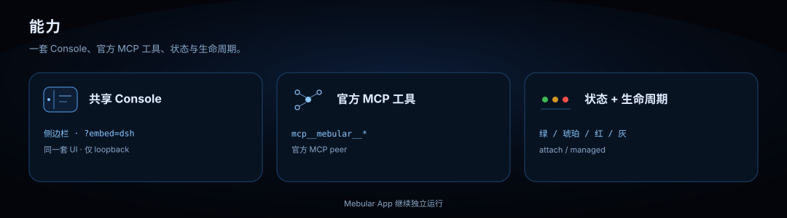

</div>

## 使用说明

<div align="center">

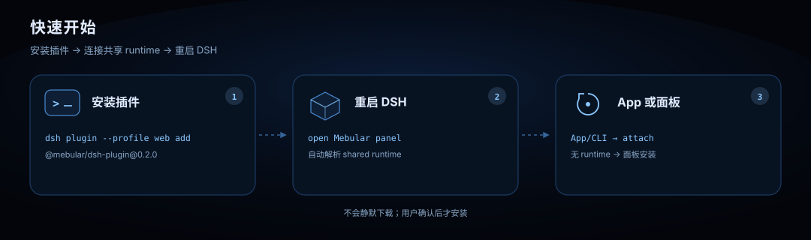

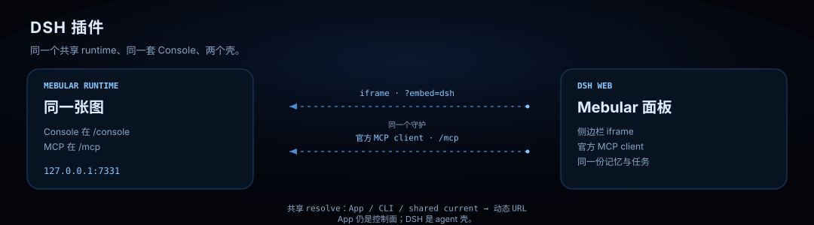


</div>

已有 Mebular App 或 CLI 时，插件会自动连接；没有 runtime 时，打开 Mebular 面板按提示安装共享 runtime。只有 CLI 方式需要手动 `mebular serve`。

> **Fleet 执行口径**：`@mebular/dsh-plugin` 是 DSH 的 **Web/记忆桥**（Console 面板 + 官方 MCP 工具），**不是 Fleet executor**。下表的 `task_*` 是派发/查询/控制入口，不等于在本机执行任务。DSH v1 作为执行宿主时使用官方 `dsh --profile headless "<job>"`；`dsh --profile sdk` 属于 v2，不作为当前口径。Fleet 的派发方/执行方矩阵见 [Fleet 设计](../fleet/DESIGN.md) §2.5.3。

### 命令行

```bash
# 安装插件（不会静默启动或下载 Mebular）
dsh plugin --profile web add @mebular/dsh-plugin@0.3.0

# 开发安装
dsh plugin --profile web add ./packages/dsh-plugin

# 验证：在 DSH 中调用任意 mcp__mebular__* 工具
# 卸载
dsh plugin --profile web remove @mebular/dsh-plugin
```

## MCP 工具

DSH 通过官方 MCP client 连接同一个 daemon 的 `/mcp`；工具在 DSH 里显示为 `mcp__mebular__*`。

| 能力 | 工具 | MCP 说明 |
| --- | --- | --- |
| 记忆写入 | `memory_write` `memory_write_batch` | 写入单条/批量事实、偏好、情节与技能；写入即签名并参与同步 |
| 记忆召回 | `memory_query` `memory_search` `memory_graph` | 语义/关键词召回、图遍历；可按时间与关系过滤 |
| 画像与历史 | `memory_profile` `memory_skills` `memory_history` | 读取用户偏好、技能清单与会话情节 |
| 记忆维护 | `memory_import` `memory_status` `memory_sync` `memory_delete` `memory_archive` | 导入、状态、同步、墓碑删除、归档/解除归档 |
| 任务派发 | `task_submit` `task_submit_batch` `task_cancel` `task_retry` `task_status` `task_list` `task_history` `task_children` `task_summarize` | 派发、取消、重试与查询任务 DAG |
| 协作协商 | `task_subscribe` `task_negotiate` `chatter_send` `chatter_inbox` `task_quota` `task_targets` `board_create` | 变更订阅、协商、配额闲聊、目标与任务板 |

## 文档

| 开始 | 理解 | 运维 | 信任 |
| --- | --- | --- | --- |
| **[快速上手](https://github.com/Windsander/Mebular/blob/main/docs/getting-started/QUICKSTART_CN.md)** <br><sub>安装与配对</sub> | **[架构](https://github.com/Windsander/Mebular/blob/main/docs/architecture/ARCHITECT.md)** <br><sub>节点与同步</sub> | **[控制台](https://github.com/Windsander/Mebular/blob/main/docs/console/README.md)** <br><sub>本地界面</sub> | **[限制](https://github.com/Windsander/Mebular/blob/main/docs/limitations/LIMITATIONS_CN.md)** <br><sub>敏感数据</sub> |
| **[Agent](https://github.com/Windsander/Mebular/blob/main/packages/skill/SETUP.md)** <br><sub>部署规约</sub> | **[Fleet](https://github.com/Windsander/Mebular/blob/main/packages/fleet/RUNBOOK.md)** <br><sub>多机操作</sub> | **[共享 runtime](https://github.com/Windsander/Mebular/blob/main/docs/operations/SHARED_RUNTIME.md)** <br><sub>安装、升级与回滚</sub> | **[封板契约](https://github.com/Windsander/Mebular/blob/main/SEALING_CN.md)** <br><sub>协议红线</sub> |
| **[变更日志](https://github.com/Windsander/Mebular/blob/main/CHANGELOG.md)** <br><sub>发布说明</sub> | **[参与贡献](https://github.com/Windsander/Mebular/blob/main/CONTRIBUTING.md)** <br><sub>质量门禁</sub> | **[安全](https://github.com/Windsander/Mebular/blob/main/SECURITY.md)** <br><sub>报告漏洞</sub> | **[官网](https://mebular.cyberfederal.io)** <br><sub>产品站点</sub> |
| **[DSH 集成说明](https://github.com/Windsander/Mebular/blob/main/docs/integrations/DSH_CN.md)** <br><sub>完整配置</sub> | **[DSH E2E](https://github.com/Windsander/Mebular/blob/main/docs/operations/DSH_E2E.md)** <br><sub>CI 门禁</sub> | **[npm](https://www.npmjs.com/package/@mebular/dsh-plugin)** <br><sub>包页面</sub> | **[awesome-dsh-plugin](https://awesome-dsh-plugin.com/zh/p/Windsander/Mebular--packages-dsh-plugin/)** <br><sub>插件列表</sub> |

### 兼容发现

| 场景 | 解析方式 |
| --- | --- |
| 共享 runtime 可用 | 共享 runtime resolve（App / CLI / shared） |
| 旧环境 / 无共享 CLI | `daemonUrl > MEBULAR_HTTP_PORT > runtime.json > 7331` |
| Memory Runtime sidecar | `memoryRuntime.url > MEBULAR_MEMORY_RUNTIME_URL > <home>/memory-runtime.json`（不猜端口） |
| `MEBULAR_HOME` | 定位 daemon 与 sidecar discovery |
| Mebular App | 独立运行；连接同一个 daemon |

<div align="center">

v0.3.0 · early · MIT · © 2026 Sobert Li

</div>
