<div align="center">

<picture>
  <source media="(prefers-color-scheme: light)" srcset="https://raw.githubusercontent.com/Windsander/Mebular/HEAD/assets/dsh-plugin-hero-light.svg?v=3">
  
</picture>

<details>
<summary>System-theme fallback</summary>


</details>

**One memory. Every assistant. Every device.**

A distributed memory network for your AI assistants. Memory and tasks stay on your devices; devices sync directly.

[](https://github.com/Windsander/Mebular/actions/workflows/ci.yml) [](https://github.com/Windsander/Mebular/blob/main/LICENSE) [](https://github.com/Windsander/Mebular/blob/main/docs/getting-started/QUICKSTART.md) [](https://github.com/Windsander/Mebular/blob/main/docs/getting-started/QUICKSTART.md) [](https://awesome-dsh-plugin.com/p/Windsander/Mebular--packages-dsh-plugin/)

[Start in 5 minutes](https://github.com/Windsander/Mebular/blob/main/docs/getting-started/QUICKSTART.md) · [How it works](https://github.com/Windsander/Mebular/blob/main/docs/architecture/ARCHITECT.md) · [Website](https://mebular.cyberfederal.io) · [中文](https://github.com/Windsander/Mebular/blob/main/packages/dsh-plugin/README.md)

*No hosted account · No central coordinator*

The App and the DSH Plugin are two entries to the same local runtime.
The Plugin defaults to `attach`; it never starts or downloads Mebular silently.

</div>

---

<div align="center">

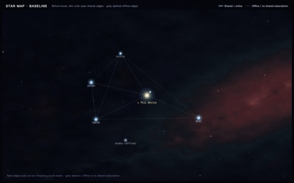 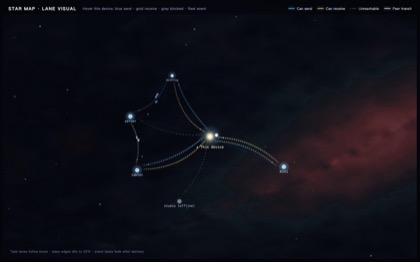

*The map at rest: devices and their shared-subscription edges. · On hover: task-domain lanes plus live fleet traffic. Blue and gold show this device's two-way task-domain reachability, not peer-to-peer links.*

</div>

| Full DSH panel · entry and star map | Collapsed sidebar · full Console | Shared memory view | Settings and keep-running |
| --- | --- | --- | --- |
| [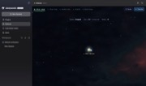](https://raw.githubusercontent.com/Windsander/Mebular/HEAD/assets/dsh-plugin-demo-en-normal.jpg) | [](https://raw.githubusercontent.com/Windsander/Mebular/HEAD/assets/dsh-plugin-demo-en-collapsed.jpg) | [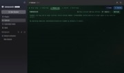](https://raw.githubusercontent.com/Windsander/Mebular/HEAD/assets/dsh-plugin-demo-en-memories.jpg) | [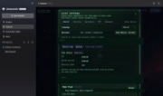](https://raw.githubusercontent.com/Windsander/Mebular/HEAD/assets/dsh-plugin-demo-en-settings.jpg) |

## Runtime modes

<div align="center">

<picture>
  <source media="(prefers-color-scheme: light)" srcset="https://raw.githubusercontent.com/Windsander/Mebular/HEAD/assets/one-graph-en-light.svg?v=3">
  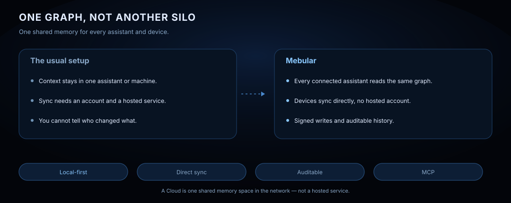
</picture>

<picture>
  <source media="(prefers-color-scheme: light)" srcset="https://raw.githubusercontent.com/Windsander/Mebular/HEAD/assets/memory-runtime-en-light.svg?v=3">
  
</picture>

<details>
<summary>System-theme fallback</summary>


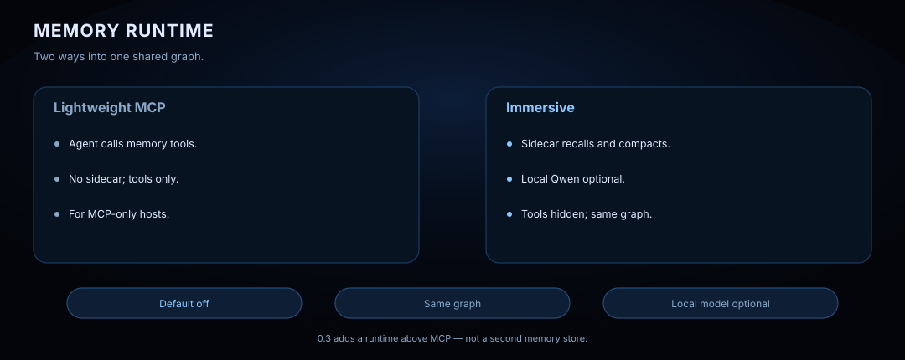

</details>

*0.3 adds an optional runtime above MCP. Default off; local Qwen optional.*

[Runtime guide](https://github.com/Windsander/Mebular/blob/main/docs/guides/MEMORY_RUNTIME.md) · [DSH integration](https://github.com/Windsander/Mebular/blob/main/docs/integrations/DSH.md)

</div>

## DSH integration

<div align="center">

<picture>
  <source media="(prefers-color-scheme: light)" srcset="https://raw.githubusercontent.com/Windsander/Mebular/HEAD/assets/dsh-memory-mesh-en-light.svg?v=3">
  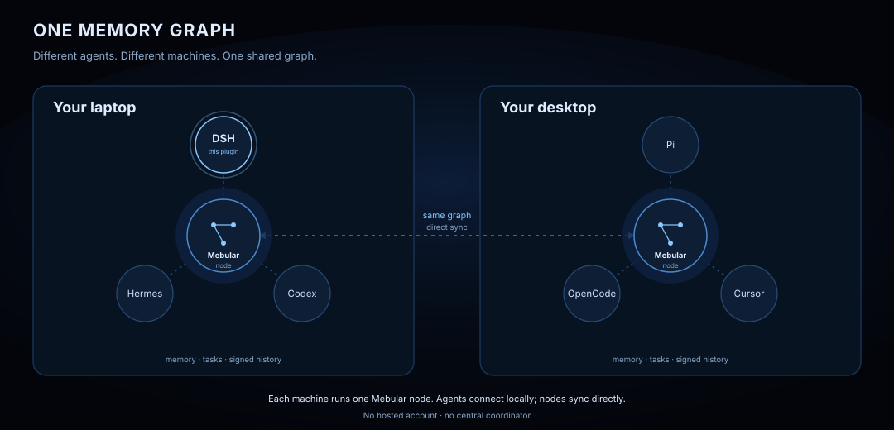
</picture>

<picture>
  <source media="(prefers-color-scheme: light)" srcset="https://raw.githubusercontent.com/Windsander/Mebular/HEAD/assets/dsh-capabilities-en-light.svg?v=3">
  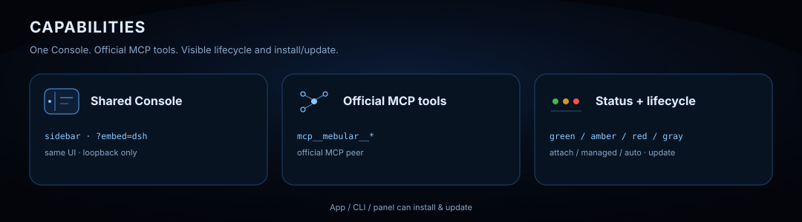
</picture>

<details>
<summary>System-theme fallback</summary>


</details>

</div>

## Usage

<div align="center">

<picture>
  <source media="(prefers-color-scheme: light)" srcset="https://raw.githubusercontent.com/Windsander/Mebular/HEAD/assets/dsh-quickstart-en-light.svg?v=3">
  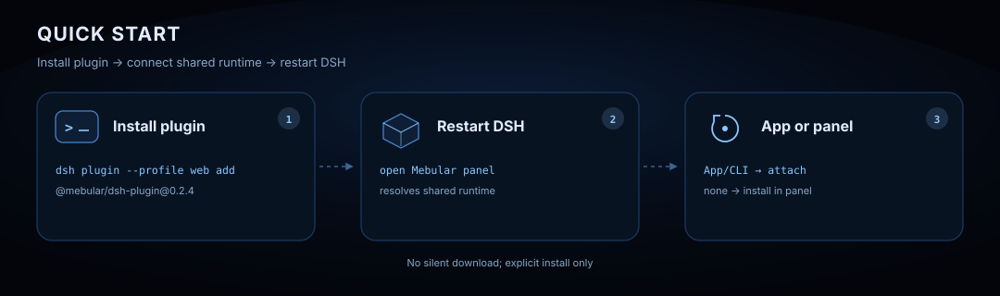
</picture>

<picture>
  <source media="(prefers-color-scheme: light)" srcset="https://raw.githubusercontent.com/Windsander/Mebular/HEAD/assets/dsh-connection-en-light.svg?v=3">
  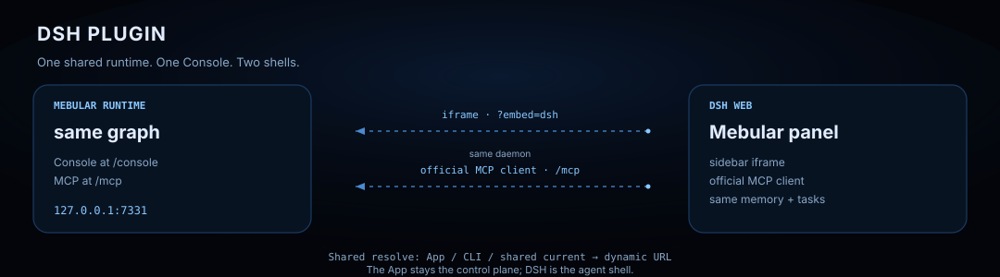
</picture>

<picture>
  <source media="(prefers-color-scheme: light)" srcset="https://raw.githubusercontent.com/Windsander/Mebular/HEAD/assets/dsh-status-en-light.svg?v=3">
  
</picture>

<details>
<summary>System-theme fallback</summary>


</details>

</div>

An existing Mebular app or CLI attaches automatically; when no runtime exists, open the Mebular panel and install the shared runtime when prompted. Only the CLI-only path needs `mebular serve`.

> **Fleet execution scope**: `@mebular/dsh-plugin` is DSH's **Web/memory bridge** (Console panel plus official MCP tools), **not a Fleet executor**. The `task_*` tools below are dispatch/query/control entry points, not proof that this host executes tasks. To run DSH v1 as an execution host, use the official `dsh --profile headless "<job>"`; `dsh --profile sdk` belongs to v2 and is not the current scope. See the dispatcher vs executor matrix in [Fleet design](../fleet/DESIGN.md) §2.5.3.

### Commands

```bash
# Install the plugin (it never starts or downloads Mebular silently)
dsh plugin --profile web add @mebular/dsh-plugin@0.3.0

# Development install
dsh plugin --profile web add ./packages/dsh-plugin

# Verify: call any mcp__mebular__* tool in DSH
# Uninstall
dsh plugin --profile web remove @mebular/dsh-plugin
```

## MCP tools

DSH reaches the same daemon at `/mcp` through the official MCP client; tools appear as `mcp__mebular__*`.

| Area | Tools | MCP behavior |
| --- | --- | --- |
| Memory write | `memory_write` `memory_write_batch` | Write facts, preferences, episodes and skills; signed and synced |
| Memory recall | `memory_query` `memory_search` `memory_graph` | Semantic/keyword recall and graph traversal |
| Profile and history | `memory_profile` `memory_skills` `memory_history` | Preferences, skills and session episodes |
| Memory maintenance | `memory_import` `memory_status` `memory_sync` `memory_delete` `memory_archive` | Import, status, sync, delete, archive |
| Task dispatch | `task_submit` `task_submit_batch` `task_cancel` `task_retry` `task_status` `task_list` `task_history` `task_children` `task_summarize` | Dispatch, cancel, retry, query tasks |
| Collaboration | `task_subscribe` `task_negotiate` `chatter_send` `chatter_inbox` `task_quota` `task_targets` `board_create` | Subscribe, negotiate, chatter, targets, boards |

## Docs

| Start | Learn | Run | Trust |
| --- | --- | --- | --- |
| **[Quickstart](https://github.com/Windsander/Mebular/blob/main/docs/getting-started/QUICKSTART.md)** <br><sub>Install &amp; pair</sub> | **[Architecture](https://github.com/Windsander/Mebular/blob/main/docs/architecture/ARCHITECT.md)** <br><sub>Nodes &amp; sync</sub> | **[Console](https://github.com/Windsander/Mebular/blob/main/docs/console/README.md)** <br><sub>Local GUI</sub> | **[Limitations](https://github.com/Windsander/Mebular/blob/main/docs/limitations/LIMITATIONS.md)** <br><sub>Sensitive data</sub> |
| **[Agent skills](https://github.com/Windsander/Mebular/blob/main/packages/skill/SETUP.md)** <br><sub>Setup playbooks</sub> | **[Fleet ops](https://github.com/Windsander/Mebular/blob/main/packages/fleet/RUNBOOK.md)** <br><sub>Multi-machine</sub> | **[Shared runtime](https://github.com/Windsander/Mebular/blob/main/docs/operations/SHARED_RUNTIME.md)** <br><sub>Install/upgrade/rollback</sub> | **[Sealing docs](https://github.com/Windsander/Mebular/blob/main/SEALING.md)** <br><sub>Protocol rules</sub> |
| **[Changelog](https://github.com/Windsander/Mebular/blob/main/CHANGELOG.md)** <br><sub>Release notes</sub> | **[Contributing](https://github.com/Windsander/Mebular/blob/main/CONTRIBUTING.md)** <br><sub>Quality gates</sub> | **[Security](https://github.com/Windsander/Mebular/blob/main/SECURITY.md)** <br><sub>Report a vuln</sub> | **[Website](https://mebular.cyberfederal.io)** <br><sub>Product site</sub> |
| **[DSH integration](https://github.com/Windsander/Mebular/blob/main/docs/integrations/DSH.md)** <br><sub>Full reference</sub> | **[DSH E2E](https://github.com/Windsander/Mebular/blob/main/docs/operations/DSH_E2E.md)** <br><sub>CI gates</sub> | **[npm](https://www.npmjs.com/package/@mebular/dsh-plugin)** <br><sub>Package page</sub> | **[awesome-dsh-plugin](https://awesome-dsh-plugin.com/p/Windsander/Mebular--packages-dsh-plugin/)** <br><sub>Plugin list</sub> |

### Discovery &amp; compatibility

| Case | Resolution |
| --- | --- |
| Shared runtime available | Shared runtime resolve (App / CLI / shared) |
| Legacy / no shared CLI | `daemonUrl > MEBULAR_HTTP_PORT > runtime.json > 7331` |
| Memory Runtime sidecar | `memoryRuntime.url > MEBULAR_MEMORY_RUNTIME_URL > <home>/memory-runtime.json` (never guesses a port) |
| `MEBULAR_HOME` | Locates daemon and sidecar discovery files |
| Mebular app | Independent; connects to the same daemon |

<div align="center">

v0.3.0 · early · MIT · © 2026 Sobert Li

</div>
